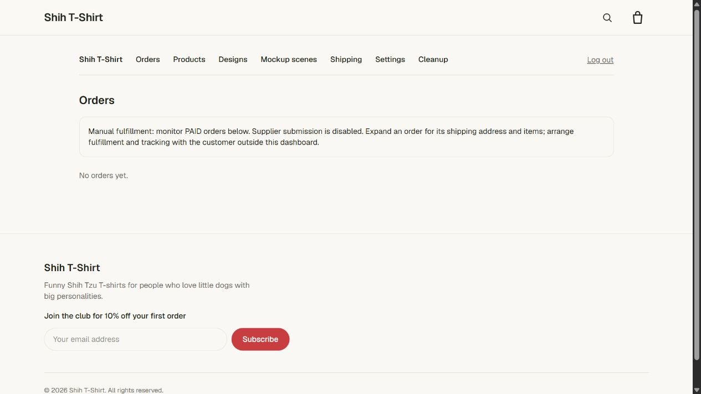

# Admin login retains the browser's store origin

## Reproduction

On `https://shihtshirts.com/admin/login`, submitting the correct store password
saved a valid admin session but left the login page displayed with Bird Nerd
branding. A fresh browser navigation to `https://shihtshirts.com/admin` opened
the correct ShihTshirts dashboard using that same session. The password hash was
not the cause, and no Bird Nerd admin access was granted.

The login Server Action previously called `redirect("/admin")`. Next's action
handler can fulfill that redirect by fetching/rendering the destination through
its internal server origin. The observed hosted behavior loses the public tenant
context on that internal render; normal browser requests retain it. PODSite's
store resolver falls back to DEV_STORE_SLUG when the request host/hints do not
match a store, explaining the unrelated branding. No production runtime headers
were logged, so the exact proxy header difference is inferred from the source
and the browser reproduction.

## Fix

After the unchanged password check and session creation, the action returns a
success flag. The login form then uses `window.location.assign("/admin")` to make
a fresh same-origin document request. The browser sends the saved session cookie
and, for local development, the existing store-hint cookie. There is no custom
domain or tenant name in this logic, and no user-controlled redirect destination.
A successful state also includes a normal Continue to admin link as a fallback
and disables another submission while navigation begins.

Wrong-password behavior, store resolution, password hashing, cookie flags,
session validation, and agent authentication are unchanged. Do not weaken tenant
checks or reset credentials to work around the redirect. This change does not
enable checkout or alter product/store data.

## Immediate workaround and release

After submitting the correct password, navigate directly to `/admin` on the same
store domain. This was verified against the deployed ShihTshirts store.

The code fix requires the normal app merge/deployment process. It has not been
merged or deployed by this task. No database migration or environment change is
required, and the password does not need another reset.

## Validation

- `npm run lint`: passed without warnings on the final change.
- `node --import tsx --test tests/*.test.ts`: 3 passed, no preload.
- `node node_modules/tsx/dist/cli.mjs --test tests/*.test.ts`: 3 passed, no preload.
- `npm run build -- --webpack`: passed, including TypeScript and route generation.
  This uses the already verified alternative backend; Next's existing middleware
  deprecation and dependency Edge-runtime warnings were observed on the initial build.
- Browser verification against the local **production** server, with the configured
  database: incorrect password displays the normal error; correct password opens
  `/admin` with ShihTshirts branding without manual reload; switching to Bird Nerd's
  development store hint rejects the ShihTshirts session and displays its login
  page; switching back to ShihTshirts restores the valid session.
- Deployed app diagnosis was read-only apart from creating the requested login
  session. Local browser tests only created cookies; no store/product/order data
  or credentials were modified by this fix.

